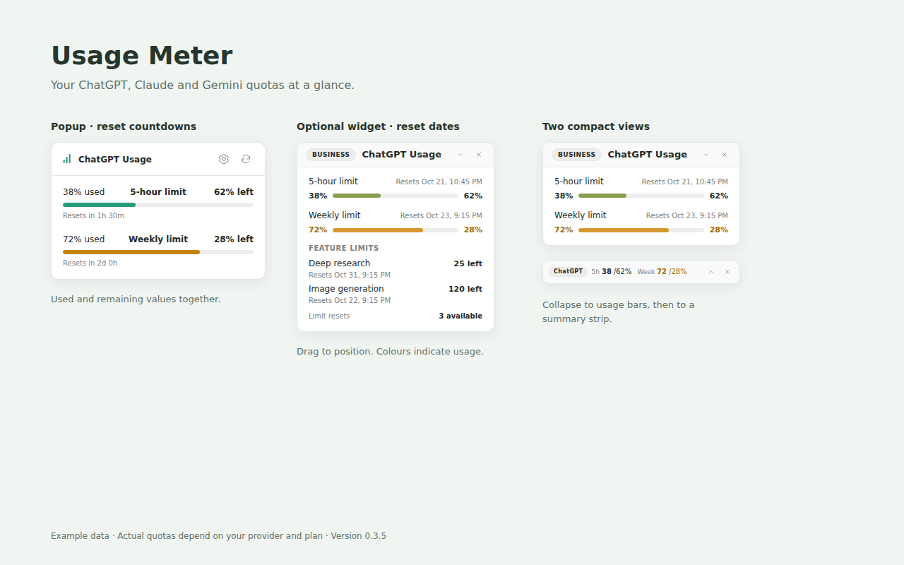
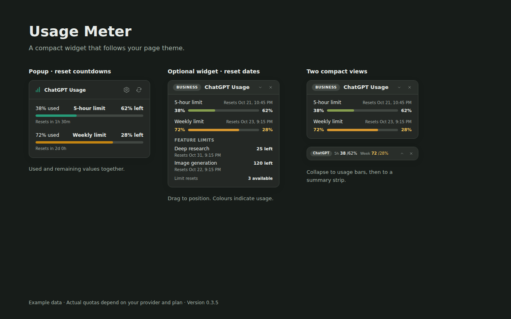
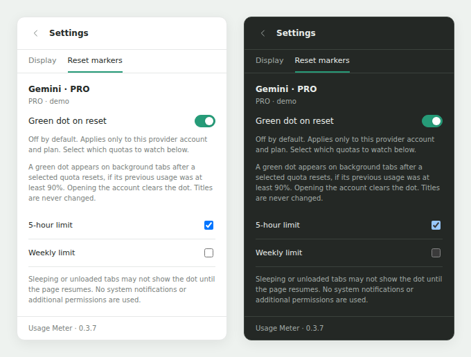

# Usage Meter

A Chrome Manifest V3 extension that displays usage limits from the signed-in web sessions of **ChatGPT, Claude, Gemini and Grok**. No API keys, CLI tools or separate desktop applications are required.

The toolbar badge follows the active tab. An optional floating widget shows usage and reset times inside each supported service. Other sites have no percentage badge.

## Screenshots

Light and dark views of the popup and the widget's three display levels. Both images are 1280 × 800 and use example data captured with version 0.3.5; actual quotas depend on the provider and plan.





## Features

- Session and weekly usage windows, when reported by the provider. Other window lengths keep their actual duration.
- Used and remaining percentages shown together. The toolbar badge can display either value and alternates between the main windows.
- A compact, draggable widget with three views: all quotas, usage bars only, and a summary strip.
- Light and dark widget themes following the page.
- Gradual green → amber → red widget bars. Widget numbers turn amber at **70% used** and red at **90% used**.
- ChatGPT feature counts, reset credits and available model information when returned by the service.
- Separate caches for providers and verified account contexts. Multiple tabs for the same context share refresh work.
- Manual refresh, automatic polling, request backoff and diagnostics without session credentials or chat content.
- Optional green favicon dots after confirmed resets of selected quota windows. Disabled by default; configured from the active provider account's settings.

## Install

1. Clone this repository or download and extract its source ZIP.
2. Open `chrome://extensions` and enable **Developer mode**.
3. Choose **Load unpacked** and select the repository's **`extension`** directory, which contains `manifest.json`.
4. Allow access to the supported sites and pin the extension if you want to see the badge.
5. Open ChatGPT, Claude, Gemini or Grok. Enable **Floating widget** in the popup settings if needed.

Chrome/Chromium 120 or newer is required. There is no build step and no runtime dependency installation.

### Update

Keep the same local `extension` directory. Pull or replace its files, click the extension's reload button in `chrome://extensions`, and refresh the open chat tabs once so that the page observers use the new version. Loading a different directory may create another extension instance.

## Interface

The popup and widget show **used on the left and remaining on the right**. The **Used / Left** setting affects the toolbar badge only. The popup shows time until reset; the widget shows the reset date and time in the browser's local timezone.

The widget's collapse button cycles through all quotas → usage bars → summary strip → all quotas. Drag its header to move it. Its position and display level are shared settings; each tab still shows its own provider/account values.

### Count-only quota colours

Some ChatGPT feature responses report only a remaining count, without the total allowance. For those rows the extension saves the **highest remaining count observed for that account and plan** as a local colour reference. The tooltip identifies this reference; it is not presented as a published quota or converted into an estimated percentage.

Integer warning thresholds are rounded down in used units. With a reference of 5, 2 remaining is amber and 1 or 0 is red. Zero is always red. A newly seen nonzero count stays neutral until there is evidence of consumption relative to an observed reference. Switching plans starts a new reference.

Version 0.3.6 adds Grok Free counts and experimental paid-pool support. The 0.3.5 store package remains separate and has no Grok permission.

### Reset markers (0.3.7)

Open a supported provider tab, then choose **Settings → Reset markers**. Enable **Green dot on reset** and select the quota windows to watch. Settings are separate for each verified provider account and plan; five-hour, weekly and other reported windows can be selected independently. Nothing is enabled automatically.



A window is watched after a fresh reading reaches **90% used**. A green dot appears on the background account's favicons only after a fresh provider response confirms a later window and usage below 90%, after the previous deadline. Passing a countdown, an error, a missing window or a stale zero never creates a dot. Viewing any tab for the account acknowledges its dots. The page title and toolbar percentages are unchanged. Events and acknowledgement survive service-worker restarts.

Claude chat-event-only readings, Gemini DOM estimates, Grok Free's missing reset timestamp and ChatGPT count-only feature estimates cannot confirm a background reset. Their quota rows are disabled with an explanation. Eligibility follows the actual reported data, not an assumed plan name. Frozen or discarded tabs may delay favicon changes until their page resumes; their state remains local. No system notifications or new permissions are used.

The extension overlays the current page icon where it can read it. If the icon cannot be read because of cross-origin restrictions, the marker falls back to a dot on a transparent favicon. A provider's CSP can prevent custom icons. Provider icon changes are observed and the underlying icon is restored when the marker is cleared or the content controller is removed.

## Provider behaviour

| Provider | Source | Relevant limitation |
| --- | --- | --- |
| ChatGPT | Session-authenticated usage and conversation-init metadata | A Free account's reported Work/Codex pool is not a counter for all ChatGPT messages. Business workspace selection is verified. |
| Claude | Organization usage REST plus quota events from normal chat responses and timelines | In the tested Free account REST returns null windows. A numeric reading can therefore require a normal chat response; the extension does not send a message to obtain it. |
| Grok | Cookie-authenticated Free REST or paid gRPC-Web | Free: Fast remaining/total counts and actual window duration, without an invented reset time. Paid: shared weekly pool and product contributions; not live-tested on a paid account. |
| Gemini | Cookie-authenticated usage GraphQL | The Relay descriptor is discovered from the public client bundle before a direct JSON request. Native request capture and the Usage page are fallback sources. These are Gemini web quotas, separate from CLI/Antigravity quotas. |

Claude event readings are last observed reports, not continuous confirmation of activity on other devices. Expired event windows disappear until another report arrives. Unknown, missing and failed readings are never replaced with zero.

These are internal web endpoints, not supported public APIs. Provider changes may require adapter updates. Perplexity is not included.

## Refresh and account handling

Automatic polling runs approximately every five minutes while supported tabs are open. The heavier Gemini page fallback has a longer interval. Returning to a tab, opening the popup, finishing a response or using manual refresh can also request an update. Rate-limit backoff is respected even for manual refreshes.

The badge is set per tab and follows the active window/tab. Worker restarts restore current bindings from session storage. An unverified account switch hides the previous account's data. Browser profiles have independent extension storage; the extension does not create separate logins for tabs sharing the same site cookies.

## Privacy

See [PRIVACY.md](PRIVACY.md). Store materials for the separate 0.3.5 submission are in `docs/store/`, with its version-specific policy in `docs/privacy-0.3.5.md`.

## Permissions and stored data

- **`storage`**: settings, normalized quota readings, account fingerprints, public Gemini request descriptors and observed count references.
- **`alarms`**: scheduled updates and badge rotation.
- **`scripting`**: account checks, same-origin requests, observers and widget injection.
- **`cookies`**: reading the Claude and Grok session cookies for account separation. It is not modified or persisted.
- Host access is limited to **`chatgpt.com`**, **`claude.ai`** and **`gemini.google.com`** and **`grok.com`**.

Session tokens and raw cookie values are not saved or included in copied diagnostics. The extension does not export chat text. Page observers inspect copies of relevant responses and retain only quota fields. Public Gemini modules are read as text to find a Relay descriptor; downloaded JavaScript is never evaluated. There is no analytics service or third-party telemetry endpoint.

## Development and checks

```text
extension/          Load this directory into Chrome
tests/              Node and browser regression tests
README-RU.md        Russian documentation and release notes
```

Run the dependency-free unit tests with Node.js 20 or newer:

```sh
node --test tests/*.test.mjs
```

Browser checks use Playwright and a local Chromium installation:

```sh
npm install --no-save playwright
npx playwright install chromium
node tests/ui.browser.cjs
node tests/widget.browser.cjs
node tests/data.browser.cjs
node tests/gemini-network.browser.cjs
node tests/gemini-discovery.browser.cjs
node tests/gemini-redirect.browser.cjs
node tests/grok.browser.cjs
node tests/reset-markers.browser.cjs
```

`METER_PLAYWRIGHT_MODULE` and `METER_CHROMIUM_PATH` can point to existing installations. These are test dependencies only. The tests use synthetic accounts and controlled HTTP/stream responses; they do not require a live login or spend model usage.

Before sharing a problem report, use **Settings → Copy diagnostics** and describe the provider and relevant account/plan. Do not attach cookies, access tokens, browser profiles or unredacted HAR files.

## Acknowledgements

The implementation is independent. Grok endpoint and field mappings were investigated using Joshua Wang’s Grok Usage Watch source and changelog; its source has not been copied into this package. Open-source protocol investigations, including CodexBar's Gemini web adapter and Claude quota-event trackers, informed the provider adapters. The widget's visual references were the usage trackers discussed during development; their donation controls and theme presets are not included.


Create an upload-ready ZIP (manifest at the archive root) with `python3 tools/package.py`. Use `--version 0.3.5` or `--version 0.3.6` for the preserved earlier builds. The current package defaults to 0.3.7.
